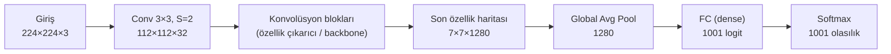
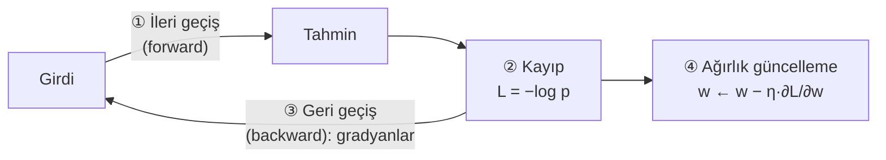
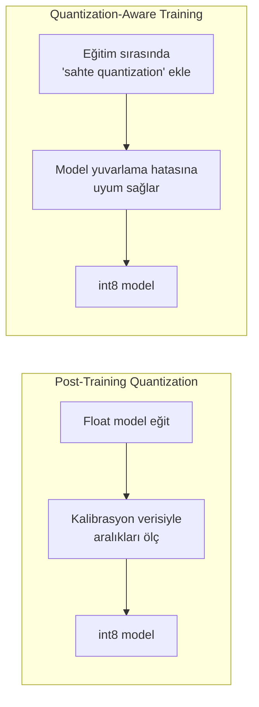
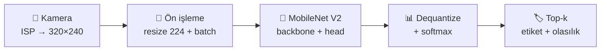

# 📖 Görüntü Sınıflandırma — Sıfırdan Kapsamlı Teori

> Bu doküman, [Bölüm 2 ders notundaki](02-image-classification-temelleri.md) uygulamanın **teorik arka planıdır**.
> Hedef: "Model bir resme bakıp nasıl *kedi* diyor?" sorusunu, hiçbir boşluk bırakmadan, adım adım ve sayısal örneklerle cevaplamak.
> Her bölümün sonunda kısa bir **"Kendini test et"** sorusu vardır (cevaplar açılır kutuda).

---

## İçindekiler

**Kısım I — Temeller**
1. [Görüntü sınıflandırma nedir?](#1-görüntü-sınıflandırma-nedir)
2. [Bilgisayar bir görüntüyü nasıl görür?](#2-bilgisayar-bir-görüntüyü-nasıl-görür)
3. [Klasik yöntemlerden derin öğrenmeye](#3-klasik-yöntemlerden-derin-öğrenmeye)

**Kısım II — Sinir ağının yapı taşları**

4. [Yapay nöron](#4-yapay-nöron)
5. [Aktivasyon fonksiyonları](#5-aktivasyon-fonksiyonları)
6. [Konvolüsyon: CNN'in kalbi](#6-konvolüsyon-cnnin-kalbi)
7. [Pooling, batch normalization ve diğer katmanlar](#7-pooling-batch-normalization-ve-diğer-katmanlar)
8. [Bir CNN'in tam anatomisi](#8-bir-cnnin-tam-anatomisi)
9. [Çıkış: logit, softmax ve olasılık](#9-çıkış-logit-softmax-ve-olasılık)

**Kısım III — Eğitim**

10. [Model nasıl öğrenir? Kayıp fonksiyonu](#10-model-nasıl-öğrenir-kayıp-fonksiyonu)
11. [Gradient descent ve backpropagation](#11-gradient-descent-ve-backpropagation)
12. [Veri: train / validation / test ve augmentation](#12-veri-train--validation--test-ve-augmentation)
13. [Overfitting ve underfitting](#13-overfitting-ve-underfitting)
14. [Başarıyı ölçmek: metrikler](#14-başarıyı-ölçmek-metrikler)

**Kısım IV — Edge için sınıflandırma**

15. [Transfer learning](#15-transfer-learning)
16. [Mimari tarihi: LeNet'ten MobileNet'e](#16-mimari-tarihi-lenetten-mobilenete)
17. [MobileNet V1 ve V2 derinlemesine](#17-mobilenet-v1-ve-v2-derinlemesine)
18. [Quantization derinlemesine](#18-quantization-derinlemesine)
19. [Edge'de doğruluk–hız ödünleşimi](#19-edgede-doğrulukhız-ödünleşimi)
20. [Her şeyi birleştirmek: teoriden koda](#20-her-şeyi-birleştirmek-teoriden-koda)

[Sonuç ve kaynaklar](#sonuç-ve-kaynaklar)

---

# Kısım I — Temeller

## 1. Görüntü sınıflandırma nedir?

**Görüntü sınıflandırma**, bir görüntünün **tamamına**, önceden tanımlanmış sınıflardan **bir tane** etiket atama işidir.

```
           ┌─────────────────┐
  🖼️  ───▶ │  Sınıflandırıcı │ ───▶  "kedi" (%92)
           └─────────────────┘
```

### Bilgisayarlı görü görevleri arasındaki yeri

| Görev | Soru | Çıktı | Örnek |
|---|---|---|---|
| **Sınıflandırma** | Bu görüntüde *ne* var? | Tek etiket (+ olasılık) | "kedi" |
| **Nesne tespiti** (detection) | *Neler* var ve *nerede*? | Her nesne için etiket + kutu (bounding box) | "kedi [x,y,w,h]", "köpek [x,y,w,h]" |
| **Anlamsal bölütleme** (semantic segmentation) | Her piksel *neye* ait? | Piksel başına sınıf haritası | Kedinin pikselleri boyalı |
| **Örnek bölütleme** (instance segmentation) | Her nesnenin *tam şekli*? | Nesne başına maske | Kedi 1 ve kedi 2 ayrı maskeler |

> 💡 Sınıflandırma en basit görevdir ama diğerlerinin **temelidir**: tespit ve bölütleme modellerinin çoğu, içinde bir sınıflandırma ağını (**backbone**) "özellik çıkarıcı" olarak kullanır. Bölüm 4'te göreceğimiz SSD MobileNet de MobileNet'i backbone olarak kullanır.

### Sınıflandırma türleri

| Tür | Açıklama | Çıkış aktivasyonu |
|---|---|---|
| **İkili** (binary) | 2 sınıf: "kusurlu / sağlam" | sigmoid (tek çıktı) |
| **Çok sınıflı** (multi-class) | N sınıftan **tam olarak biri**: "kedi / köpek / kuş" | softmax |
| **Çok etiketli** (multi-label) | Aynı anda **birden fazla** etiket olabilir: "plaj + gün batımı + insan" | her sınıf için ayrı sigmoid |

MobileNet V2 (ImageNet) bir **çok sınıflı** sınıflandırıcıdır: 1001 sınıftan biri.

### 📝 Kendini test et
<details>
<summary>Bir fabrikada ürünün "çizik", "ezik" ve "leke" kusurlarından hangilerini taşıdığını bulmak istiyoruz. Bir ürün aynı anda birden fazla kusura sahip olabilir. Hangi sınıflandırma türü uygun?</summary>

**Çok etiketli (multi-label).** Her kusur için ayrı bir sigmoid çıktısı kullanılır; çıktıların toplamının 1 olması gerekmez.
</details>

---

## 2. Bilgisayar bir görüntüyü nasıl görür?

Bilgisayar için bir görüntü, **sayılardan oluşan bir matristir**.

### Gri tonlamalı görüntü
Her piksel **0 (siyah) ile 255 (beyaz)** arasında tek bir sayıdır:

```
  Görüntü (5×5)          Bilgisayarın gördüğü
  ░░██░░                 [[  0,   0, 255,   0,   0],
  ░░██░░                  [  0,   0, 255,   0,   0],
  ░░██░░        ───▶      [  0,   0, 255,   0,   0],
  ░░██░░                  [  0,   0, 255,   0,   0],
  ░░██░░                  [  0,   0, 255,   0,   0]]
```

### Renkli (RGB) görüntü
Her piksel **3 sayıdır**: Kırmızı (R), Yeşil (G), Mavi (B). Görüntü, üst üste konmuş **3 matristir** (kanal):

```
       ┌─────────┐
     ┌─┴───────┐ │   ← B kanalı
   ┌─┴───────┐ │ │   ← G kanalı
   │         │ │─┘   ← R kanalı
   │  H × W  │─┘
   └─────────┘
   shape = (H, W, 3)
```

**Bölüm 2'deki gerçek örnek:**
```python
arr = np.array(Image.open("Cat03.jpg"))
arr.shape   # (1600, 1600, 3)  → 1600 satır, 1600 sütun, 3 kanal
arr.dtype   # uint8            → her değer 0–255, 1 byte
arr[0, 0]   # [217 208 177]    → sol üst piksel: açık bej
```

### Ölçek hissi
| Görüntü | Sayı adedi |
|---|---|
| 1600 × 1600 × 3 | **7 680 000** |
| 224 × 224 × 3 (MobileNet girişi) | **150 528** |
| 32 × 32 × 3 (CIFAR-10) | 3 072 |

Model, bu 150 528 sayıya bakıp "kedi" demeyi öğrenir.

### Neden zor?
Aynı kedi, piksel düzeyinde **tamamen farklı** sayılar üretebilir:

| Zorluk | Açıklama |
|---|---|
| **Bakış açısı** | Önden ve yandan kedi bambaşka piksellerdir. |
| **Ölçek** | Uzaktaki kedi 20 piksel, yakındaki 2000 piksel. |
| **Aydınlatma** | Karanlıkta tüm değerler düşer. |
| **Deformasyon** | Kedi kıvrılır, uzanır, zıplar. |
| **Örtülme** (occlusion) | Kedinin yarısı masanın arkasında. |
| **Arka plan karmaşası** | Kedi, desenli halıyla karışır. |
| **Sınıf içi çeşitlilik** | Tekir, siyam, Van kedisi... hepsi "kedi". |

> 💡 İyi bir sınıflandırıcı, bu değişimlere karşı **değişmez** (invariant) olmalıdır: kedinin yeri, boyutu, ışığı değişse de "kedi" demelidir.

### 📝 Kendini test et
<details>
<summary>224×224 boyutunda bir gri tonlamalı görüntüde kaç sayı vardır? Aynı boyutta RGB görüntüde kaç sayı vardır?</summary>

Gri: 224 × 224 = **50 176**. RGB: 224 × 224 × 3 = **150 528**.
</details>

---

## 3. Klasik yöntemlerden derin öğrenmeye

### Klasik yaklaşım (≈ 2012 öncesi)
```
Görüntü ─▶ [ İnsan tasarımı özellik çıkarıcı ] ─▶ [ Sınıflandırıcı ] ─▶ Etiket
            (HOG, SIFT, renk histogramı...)       (SVM, Random Forest)
```
- **Özellikleri insan tasarlar:** "Kenar yönlerinin histogramını al" (HOG), "köşe noktalarını bul" (SIFT).
- Sorun: Hangi özelliğin işe yarayacağını bilmek zordur ve her yeni problem için yeniden tasarlamak gerekir.

### Derin öğrenme yaklaşımı
```
Görüntü ─▶ [ Sinir ağı: özellikleri KENDİSİ öğrenir + sınıflandırır ] ─▶ Etiket
```
- **Özellikleri veriden kendisi öğrenir.** Buna *uçtan uca öğrenme* (end-to-end learning) denir.
- 2012'de **AlexNet**, ImageNet yarışmasında top-5 hatayı **%26.2'den %15.3'e** düşürdü ve derin öğrenme devrimi başladı.

| | Klasik | Derin öğrenme |
|---|---|---|
| Özellikler | İnsan tasarlar | Veriden öğrenilir |
| Veri ihtiyacı | Az | Çok (transfer learning ile azalır) |
| Hesaplama | Düşük | Yüksek (eğitimde) |
| Doğruluk (karmaşık görevler) | Düşük–orta | Yüksek |
| Açıklanabilirlik | Yüksek | Düşük |

### 📝 Kendini test et
<details>
<summary>"Uçtan uca öğrenme" ifadesi neyi anlatır?</summary>

Ham girdiden (pikseller) son çıktıya (etiket) kadar **tüm dönüşümün**, insan müdahalesi olmadan, tek bir model tarafından veriden öğrenilmesini.
</details>

---

# Kısım II — Sinir ağının yapı taşları

## 4. Yapay nöron

Bir nöron, girdilerinin **ağırlıklı toplamını** alır, bir **sapma** (bias) ekler ve sonucu bir **aktivasyon fonksiyonundan** geçirir:

```
  x₁ ──w₁──┐
  x₂ ──w₂──┼──▶ Σ (wᵢ·xᵢ) + b ──▶ f(·) ──▶ y
  x₃ ──w₃──┘
```

$$y = f\left(\sum_i w_i x_i + b\right)$$

| Sembol | Anlamı |
|---|---|
| $x_i$ | Girdiler (ör. piksel değerleri veya önceki katmanın çıktıları) |
| $w_i$ | **Ağırlıklar**: her girdinin ne kadar önemli olduğu (öğrenilir) |
| $b$ | **Bias**: eşik kaydırıcı (öğrenilir) |
| $f$ | **Aktivasyon fonksiyonu**: doğrusal olmayanlığı ekler |

### Sayısal örnek
$x = [0.5,\ 0.8,\ 0.2]$, $w = [0.4,\ -0.6,\ 0.9]$, $b = 0.1$, $f = \text{ReLU}$

$$z = 0.4·0.5 + (-0.6)·0.8 + 0.9·0.2 + 0.1 = 0.2 - 0.48 + 0.18 + 0.1 = 0.0$$
$$y = \text{ReLU}(0.0) = 0.0$$

### Katman (layer)
Aynı girdilere bakan nöronların oluşturduğu gruba **katman** denir. Bir katmanın tüm nöronları birlikte bir **matris çarpımıyla** hesaplanır:

$$\mathbf{y} = f(\mathbf{W}\mathbf{x} + \mathbf{b})$$

Her girdinin her nörona bağlı olduğu katmana **tam bağlantılı** (fully connected, FC, dense) katman denir.

### Neden görüntüde FC yetmez?
224×224×3'lük bir görüntüyü 1000 nöronlu bir FC katmana bağlarsak:
$$150\,528 \times 1000 = 150\ \text{milyon ağırlık}$$
Tek bir katman için! Üstelik FC katman, pikseller arasındaki **komşuluk** bilgisini kullanmaz. Çözüm: **konvolüsyon** (Bölüm 6).

---

## 5. Aktivasyon fonksiyonları

**Neden gerekli?** Aktivasyon olmasaydı, art arda doğrusal katmanlar yine **tek bir doğrusal fonksiyona** indirgenirdi ($W_2(W_1 x) = (W_2W_1)x$). Yani 100 katmanlı ağ, 1 katmanlı ağdan güçlü olmazdı. Aktivasyon, ağa **eğri** çizebilme (doğrusal olmayan) yeteneği kazandırır.

| Fonksiyon | Formül | Aralık | Nerede kullanılır |
|---|---|---|---|
| **ReLU** | $\max(0, x)$ | [0, ∞) | Gizli katmanların standart seçimi |
| **ReLU6** | $\min(\max(0, x), 6)$ | [0, 6] | **MobileNet** (quantization dostu) |
| **Sigmoid** | $\dfrac{1}{1+e^{-x}}$ | (0, 1) | İkili / çok etiketli çıkış |
| **Softmax** | $\dfrac{e^{x_i}}{\sum_j e^{x_j}}$ | (0, 1), toplam 1 | Çok sınıflı çıkış |
| **Swish / h-swish** | $x·\sigma(x)$ | ≈ (−0.28, ∞) | MobileNet V3, EfficientNet |

```
  ReLU                 ReLU6
    │     ╱              │    ┌────── 6
    │   ╱                │  ╱
    │ ╱                  │╱
 ───┼──────          ────┼──────
    │                    │
```

> 💡 **ReLU6 neden quantization dostu?** Çıkışı **[0, 6]** ile sınırlı olduğu için, 8-bit tam sayıya çevrilirken aralık önceden bilinir ve hassasiyet kaybı azalır. Sınırsız ReLU'da tek bir çok büyük değer, tüm aralığı "yayıp" küçük değerlerin hassasiyetini öldürebilir.

### 📝 Kendini test et
<details>
<summary>ReLU(−3), ReLU(4), ReLU6(9) kaç eder?</summary>

ReLU(−3) = **0**, ReLU(4) = **4**, ReLU6(9) = **6**.
</details>

---

## 6. Konvolüsyon: CNN'in kalbi

### 6.1 Fikir
Küçük bir **filtreyi** (kernel, örn. 3×3) görüntünün üzerinde **kaydırırız**. Her konumda filtre ile altındaki piksellerin **eleman eleman çarpımlarını toplarız**. Sonuç, yeni bir görüntüdür: **özellik haritası** (feature map).

### 6.2 Sayısal örnek: dikey kenar bulma
Sol yarısı parlak (10), sağ yarısı karanlık (0) bir görüntü:

```
 Giriş (5×5)            Filtre (3×3)          Çıkış (3×3)
 10 10 10  0  0         1  0 -1               0 30 30
 10 10 10  0  0         1  0 -1      ───▶     0 30 30
 10 10 10  0  0    ⊛    1  0 -1               0 30 30
 10 10 10  0  0
 10 10 10  0  0
```

**Sol üst konum** (satır 0–2, sütun 0–2):
$$(10·1 + 10·0 + 10·(-1)) × 3\ \text{satır} = 0$$
→ Bölge düz, kenar yok.

**Orta konum** (satır 0–2, sütun 1–3):
$$(10·1 + 10·0 + 0·(-1)) × 3 = 30$$
→ Parlaktan karanlığa **geçiş var** → güçlü yanıt!

Filtre, **dikey kenarın olduğu yerde** "yandı". İşte konvolüsyonun büyüsü: bu filtrenin değerlerini **biz yazmadık** gibi düşün. Eğitimde ağ, işine yarayan filtreleri **kendisi öğrenir**.

### 6.3 Konvolüsyonun hiperparametreleri

| Parametre | Anlamı | Etkisi |
|---|---|---|
| **Kernel boyutu** (K) | Filtrenin genişliği (3×3, 5×5, 1×1) | Bir seferde bakılan alan |
| **Stride** (S) | Filtrenin kaç piksel atlayarak kaydığı | S=2 → çıkış yarı boyuta iner |
| **Padding** (P) | Kenarlara eklenen sıfır çerçevesi | Çıkış boyutunu korumak için |
| **Filtre sayısı** (C_out) | Kaç farklı filtre kullanıldığı | Çıkıştaki kanal sayısı |

### 6.4 Çıkış boyutu formülü
$$N_{out} = \left\lfloor \frac{N_{in} - K + 2P}{S} \right\rfloor + 1$$

| Örnek | Hesap | Sonuç |
|---|---|---|
| 5×5 giriş, K=3, P=0, S=1 | (5 − 3 + 0)/1 + 1 | **3** |
| 224 giriş, K=3, P=1, S=1 | (224 − 3 + 2)/1 + 1 | **224** (boyut korunur) |
| 224 giriş, K=3, P=1, S=2 | ⌊(224 − 3 + 2)/2⌋ + 1 | **112** (yarıya iner) |

### 6.5 Çok kanallı konvolüsyon
Giriş RGB ise (3 kanal), **her filtre de 3 kanallıdır** (3×3×3). Her kanal ayrı çarpılır, **hepsi toplanır** → tek bir çıkış kanalı. 32 filtre kullanırsak 32 çıkış kanalı elde ederiz.

$$\text{Parametre sayısı} = K × K × C_{in} × C_{out} + C_{out}\ (\text{bias})$$

**Örnek:** 3×3 kernel, 3 → 32 kanal: $3·3·3·32 + 32 = 896$ parametre.
Aynı işi FC katmanla yapmak milyonlarca parametre gerektirirdi!

### 6.6 Konvolüsyonun iki süper gücü

| Özellik | Açıklama | Faydası |
|---|---|---|
| **Yerel bağlantı** (local connectivity) | Her çıkış sadece küçük bir komşuluğa bakar | Komşu pikseller arasındaki ilişkiyi yakalar |
| **Ağırlık paylaşımı** (weight sharing) | Aynı filtre görüntünün her yerinde kullanılır | Çok az parametre; kedi sol üstte de sağ altta da aynı filtreyle bulunur (**öteleme değişmezliği**) |

### 6.7 Özellik hiyerarşisi
Katmanlar üst üste dizildikçe, her katman bir öncekinin bulduklarını **birleştirir**:

```
 Katman 1        Katman 2          Katman 3           Son katmanlar
 ─ │ ╱ ╲    ─▶   köşe, doku   ─▶   göz, kulak,   ─▶   "kedi yüzü",
 (kenarlar)      (desenler)        bıyık (parçalar)    "tekerlek" (nesneler)
```

**Algılama alanı** (receptive field): Derin katmandaki bir nöronun, orijinal görüntüde "gördüğü" bölge. Her 3×3 konvolüsyonla büyür. Derin katmanlar bu yüzden bütün nesneyi "görebilir".

### 📝 Kendini test et
<details>
<summary>112×112 boyutunda bir özellik haritasına K=3, P=1, S=2 konvolüsyon uygularsak çıkış boyutu ne olur?</summary>

⌊(112 − 3 + 2)/2⌋ + 1 = ⌊55.5⌋ + 1 = **56**.
</details>

<details>
<summary>3×3 kernel ile 32 kanaldan 64 kanala giden bir konvolüsyon katmanında kaç parametre vardır?</summary>

3 · 3 · 32 · 64 + 64 = 18 432 + 64 = **18 496**.
</details>

---

## 7. Pooling, batch normalization ve diğer katmanlar

### 7.1 Pooling (havuzlama)
Özellik haritasını **küçültür**; hesap yükünü azaltır ve küçük kaymalara karşı dayanıklılık kazandırır. **Öğrenilen parametresi yoktur.**

**Max pooling 2×2, stride 2:** Her 2×2 bloktan en büyüğünü al.
```
  1  3 │ 2  1                 
  2  4 │ 0  1        ───▶      4  2
  ─────┼─────                  7  9
  5  7 │ 9  3
  6  1 │ 8  2
```

**Average pooling:** Bloğun ortalamasını alır.

**Global Average Pooling (GAP):** Her kanalın **tamamının** ortalamasını alır: (H, W, C) → (C).
MobileNet V2'nin sonunda: **(7, 7, 1280) → (1280)**. Böylece dev bir FC katmanına gerek kalmaz.

### 7.2 Batch Normalization (BN)
Her katmanın çıktısını, mini-batch istatistikleriyle **normalize eder** (ortalama ≈ 0, varyans ≈ 1), sonra öğrenilebilir bir ölçek (γ) ve kaydırma (β) uygular.
- Eğitimi **hızlandırır ve kararlı hâle getirir.**
- 💡 **Edge bilgisi:** Çıkarım için dönüştürülen modellerde (.tflite) BN, genelde bir önceki konvolüsyonun ağırlıklarına **katlanır** (*BN folding*). Yani çalışma anında ekstra maliyeti yoktur.

### 7.3 Dropout
Eğitim sırasında nöronların rastgele bir kısmını (örn. %20) **geçici olarak kapatır**. Ağ tek bir nörona aşırı güvenemez, bu da **ezberlemeyi** (overfitting) azaltır. Çıkarımda kapalıdır.

### 7.4 Flatten
Çok boyutlu tensörü düz bir vektöre açar: (7, 7, 64) → (3136). Eski mimarilerde FC'den önce kullanılırdı. Modern mimariler GAP'i tercih eder.

---

## 8. Bir CNN'in tam anatomisi



İki ana kısım vardır:

| Kısım | Görevi | MobileNet V2'de |
|---|---|---|
| **Backbone** (gövde / özellik çıkarıcı) | Görüntüden anlamlı özellikler çıkarmak | Conv + 17 inverted residual blok → 7×7×1280 |
| **Head** (baş / sınıflandırıcı) | Özellikleri sınıf puanlarına çevirmek | GAP + FC(1001) |

> 💡 Bu ayrım **transfer learning**'in (Bölüm 15) temelidir: backbone'u olduğu gibi kullanıp sadece head'i yeni sınıflarımız için değiştireceğiz. Proje 1'de tam olarak bunu yapacağız!

### Mekânsal boyut ↓, kanal sayısı ↑
Ağ derinleştikçe görüntü **küçülür** ama kanal sayısı **artar**:

| Aşama | Boyut | Anlamı |
|---|---|---|
| Giriş | 224 × 224 × 3 | Ham renk bilgisi |
| Erken katman | 112 × 112 × 32 | "Nerede kenar var?" (yüksek çözünürlük, az anlam) |
| Orta katman | 28 × 28 × 64 | "Nerede doku/parça var?" |
| Son katman | 7 × 7 × 1280 | "Nerede hangi nesne kavramı var?" (düşük çözünürlük, zengin anlam) |

---

## 9. Çıkış: logit, softmax ve olasılık

### 9.1 Logit
Son FC katmanın çıktısı, her sınıf için **ham bir puandır**: **logit**. Negatif olabilir, toplamı 1 değildir.
Bölüm 2'de gördük: dequantize sonrası min **−3.66**, max **11.37**, toplam **536**.

### 9.2 Softmax
$$p_i = \frac{e^{z_i}}{\sum_{j} e^{z_j}}$$

**Sayısal örnek:** 3 sınıf, logit'ler $z = [2.0,\ 1.0,\ 0.1]$

| Sınıf | $z_i$ | $e^{z_i}$ | $p_i = e^{z_i} / 11.213$ |
|---|---|---|---|
| kedi | 2.0 | 7.389 | **0.659** |
| köpek | 1.0 | 2.718 | 0.242 |
| kuş | 0.1 | 1.105 | 0.099 |
| **Toplam** | | **11.213** | **1.000** |

Gözlemler:
- Tüm olasılıklar **pozitif** ve toplamı **1**.
- Üstel fonksiyon farkları **büyütür**: logit farkı 1 iken olasılık oranı $e^1 ≈ 2.7$ kat.
- Sıralama korunur: en büyük logit → en büyük olasılık.

### 9.3 Sayısal kararlılık
$e^{1000}$ float32'de **sonsuza taşar**. Çözüm: Her logit'ten maksimumu çıkar.
$$\text{softmax}(z) = \text{softmax}(z - \max(z))$$
Pay ve paydadaki $e^{-\max}$ çarpanları birbirini götürdüğü için sonuç **değişmez**, ama en büyük üs 0 olur ve taşma imkânsızlaşır.

```python
e = np.exp(z - np.max(z))
p = e / e.sum()
```

### 9.4 Güven (confidence) ≠ doğruluk
Softmax olasılığı, modelin **ne kadar emin olduğunu** gösterir, **haklı olup olmadığını** değil. Model, hiç görmediği bir şeye bile yüksek güvenle yanlış etiket verebilir (**aşırı güven**, overconfidence).
Bölüm 2'de Raspberry Pi'yi "modem" (%25) olarak sınıflandırması bunun yumuşak bir örneğiydi.

### 📝 Kendini test et
<details>
<summary>Logit'ler [3, 3, 3] ise softmax olasılıkları nedir?</summary>

Hepsi eşit: **[0.333, 0.333, 0.333]**. Softmax sadece logit **farklarına** duyarlıdır.
</details>

---

# Kısım III — Eğitim

## 10. Model nasıl öğrenir? Kayıp fonksiyonu

Eğitimin amacı, ağırlıkları öyle ayarlamaktır ki model doğru sınıfa **yüksek olasılık** versin. Bunu ölçmek için bir **kayıp fonksiyonu** (loss) tanımlarız: model ne kadar yanlışsa kayıp o kadar büyük.

### Çapraz entropi kaybı (cross-entropy)
Çok sınıflı sınıflandırmanın standart kaybı:
$$L = -\log(p_{\text{doğru sınıf}})$$

| Doğru sınıfa verilen olasılık | Kayıp $-\ln(p)$ | Yorum |
|---|---|---|
| 0.99 | **0.01** | Neredeyse mükemmel |
| 0.659 | 0.417 | İyi |
| 0.5 | 0.693 | Kararsız |
| 0.1 | 2.303 | Kötü |
| 0.01 | **4.605** | Çok kötü, emin bir şekilde yanlış |

> 💡 Kayıp, model **emin bir şekilde yanıldığında** çok hızlı büyür. Bu, modeli "yanlış ama emin" olmaktan güçlü şekilde caydırır.

---

## 11. Gradient descent ve backpropagation

### 11.1 Sezgi: Sisli dağdan inmek
Sisli bir dağdasın ve vadiye (en düşük kayıp) inmek istiyorsun. Etrafı göremiyorsun ama ayağının altındaki **eğimi** hissedebiliyorsun. Her adımda **en dik iniş yönüne** küçük bir adım atarsın. İşte **gradient descent** budur.

### 11.2 Güncelleme kuralı
$$w \leftarrow w - \eta \cdot \frac{\partial L}{\partial w}$$

| Sembol | Anlamı |
|---|---|
| $\frac{\partial L}{\partial w}$ | **Gradyan**: ağırlık biraz artarsa kayıp ne kadar değişir? |
| $\eta$ | **Öğrenme oranı** (learning rate): adım büyüklüğü |
| $-$ | Gradyanın **tersi** yönünde git (kaybı azalt) |

**Öğrenme oranı seçimi kritiktir:**
```
  η çok küçük:  ·  ·  ·  ·  ·  ·  ·  ·  ·  ·  ·  ·  ▼   (çok yavaş)
  η uygun:      ·    ·     ·    ·  ▼                    (hızlı ve kararlı)
  η çok büyük:  ·          ·             ·      ↗ ↘ ↗   (zıplar, hiç inmez)
```

### 11.3 Backpropagation (geri yayılım)
Milyonlarca ağırlığın her biri için gradyanı tek tek hesaplamak imkânsız olurdu. **Backpropagation**, zincir kuralını (*chain rule*) kullanarak tüm gradyanları **çıkıştan girişe doğru tek bir geçişte** verimli şekilde hesaplar.



### 11.4 Eğitim döngüsünün terimleri

| Terim | Açıklama |
|---|---|
| **Batch (mini-batch)** | Bir güncellemede birlikte kullanılan örnek grubu (örn. 32 görüntü). |
| **Iteration (adım)** | Bir batch için ileri geçiş + geri geçiş + güncelleme. |
| **Epoch** | Tüm eğitim verisinin **bir kez** modelden geçmesi. |
| **Optimizer** | Güncelleme kuralının gelişmiş hâli: **SGD**, **Adam** (en yaygın), RMSprop. |

**Örnek:** 600 görüntü, batch boyutu 32 → bir epoch = ⌈600/32⌉ = **19 iterasyon**. 20 epoch = 380 güncelleme.

> 💡 **Eğitim ve çıkarım farkı burada netleşir:** Eğitim = ileri + **geri** geçiş + güncelleme, binlerce kez. Çıkarım = sadece **ileri** geçiş, bir kez. Bu yüzden eğitim GPU'da, çıkarım Pi'de yapılır.

---

## 12. Veri: train / validation / test ve augmentation

### 12.1 Veri ayırma
Veri setini **üçe** ayırırız:

| Küme | Tipik oran | Amacı | Benzetme |
|---|---|---|---|
| **Train** (eğitim) | %60–80 | Ağırlıkları öğrenmek | Ders kitabı |
| **Validation** (doğrulama) | %10–20 | Hiperparametre seçmek, eğitimi izlemek | Deneme sınavı |
| **Test** | %10–20 | **Son**, tarafsız performans ölçümü | Gerçek sınav |

> ⚠️ **Altın kural:** Test verisi, model geliştirilirken **asla** kullanılmaz. Test sonucuna bakıp modeli ayarlarsan, test artık "görülmemiş veri" değildir ve sonuç **iyimser** çıkar (*data leakage*, veri sızıntısı).

### 12.2 İyi bir veri setinin özellikleri
| Özellik | Neden |
|---|---|
| **Dengeli** (balanced) | Sınıflar arası örnek sayısı benzer olmalı; yoksa model çoğunluk sınıfına kayar. |
| **Çeşitli** | Farklı açı, ışık, mesafe, arka plan. |
| **Temsili** | Sahada karşılaşılacak koşulları yansıtmalı (aynı kamera, aynı ayarlar! → *training/serving skew*). |
| **Doğru etiketli** | Yanlış etiket, modele yanlış öğretir. |

### 12.3 Veri artırma (data augmentation)
Eğitim sırasında görüntülere **rastgele dönüşümler** uygulayarak veri setini yapay olarak çeşitlendirmek:

| Dönüşüm | Öğrettiği değişmezlik |
|---|---|
| Yatay çevirme (flip) | Sol–sağ yönelim |
| Döndürme (rotation) | Küçük açı farkları |
| Rastgele kırpma / zoom | Ölçek ve konum |
| Parlaklık / kontrast | Aydınlatma |
| Gürültü, bulanıklık | Sensör kalitesi |

> ⚠️ Augmentation **mantıklı** olmalı: rakam tanımada "6"yı 180° döndürürsen "9" olur! Trafik işaretinde yatay çevirme "sola dön"ü "sağa dön" yapar.

---

## 13. Overfitting ve underfitting

```
 Kayıp
   │╲
   │ ╲     validation
   │  ╲     ___________╱‾‾‾‾‾  ← overfitting başladı!
   │   ╲___╱
   │    ╲______
   │           ╲________ train
   └──────────────────────────▶ Epoch
           ↑
     en iyi nokta (early stopping)
```

| Durum | Train başarısı | Val başarısı | Anlamı | Çözümler |
|---|---|---|---|---|
| **Underfitting** | Düşük | Düşük | Model çok basit veya yeterince eğitilmedi | Daha büyük model, daha çok epoch, daha yüksek öğrenme oranı |
| **İyi uyum** | Yüksek | Yüksek (yakın) | 🎯 | — |
| **Overfitting** | **Çok yüksek** | **Düşük** | Model **ezberledi**, genelleyemiyor | Daha çok veri, augmentation, dropout, daha küçük model, **early stopping** |

> 💡 **Ezberleme benzetmesi:** Deneme sınavının cevap anahtarını ezberleyen öğrenci, o sınavdan 100 alır ama gerçek sınavda soru biraz değişince kalır.

**Early stopping:** Validation kaybı bir süre iyileşmeyince eğitimi durdurup **en iyi** ağırlıkları saklamak.

---

## 14. Başarıyı ölçmek: metrikler

### 14.1 Doğruluk (accuracy)
$$\text{Accuracy} = \frac{\text{Doğru tahmin}}{\text{Toplam tahmin}}$$

⚠️ **Dengesiz veride yanıltıcıdır:** 100 üründen 99'u sağlam, 1'i kusurlu olsun. Her şeye "sağlam" diyen aptal bir model **%99 doğruluk** alır, ama tek işi olan kusuru hiç bulamaz!

### 14.2 Karışıklık matrisi (confusion matrix)
Hangi sınıfın hangisiyle karıştırıldığını gösterir. Örnek (3 sınıf, her biri 20 test görüntüsü):

| Gerçek ↓ / Tahmin → | Pi | Kamera | Arka plan |
|---|---|---|---|
| **Pi** | **18** | 2 | 0 |
| **Kamera** | 3 | **16** | 1 |
| **Arka plan** | 0 | 1 | **19** |

- Köşegen = doğrular: 18 + 16 + 19 = 53 → Accuracy = 53/60 = **%88.3**
- Model en çok **Kamera'yı Pi sanmış** (3 kez). Belki ikisi de yeşil devre kartı olduğu için?

### 14.3 Precision, recall, F1
Bir sınıf için (örn. "Kamera"):

| Terim | Formül | Soru | Örnekteki değer |
|---|---|---|---|
| **TP** (true positive) | — | Kamera'ya kamera dedi | 16 |
| **FP** (false positive) | — | Başka şeye kamera dedi | 2 + 1 = 3 |
| **FN** (false negative) | — | Kamera'ya başka şey dedi | 3 + 1 = 4 |
| **Precision** (kesinlik) | TP / (TP + FP) | "Kamera" dediklerimin kaçı gerçekten kamera? | 16/19 = **0.842** |
| **Recall** (duyarlılık) | TP / (TP + FN) | Gerçek kameraların kaçını yakaladım? | 16/20 = **0.800** |
| **F1** | 2·P·R / (P + R) | İkisinin dengesi (harmonik ortalama) | **0.821** |

**Hangisi daha önemli?**
- **Recall kritik:** Kanser taraması, kusur tespiti → bir vakayı **kaçırmak** pahalıdır.
- **Precision kritik:** Spam filtresi → önemli bir e-postayı yanlışlıkla spam'e atmak pahalıdır.

### 14.4 Top-1 ve top-5 doğruluk
- **Top-1:** Modelin **en yüksek** tahmini doğru mu?
- **Top-5:** Doğru cevap ilk **5** tahmin arasında mı?

Bölüm 2'deki kedi için: doğru cevap "tabby" ise top-1 yanlış (tiger cat), ama top-5 doğru (3. sırada).
ImageNet'te 1000 sınıf olduğu ve bazı sınıflar çok benzer olduğu için (tiger cat / tabby / Egyptian cat) top-5 de raporlanır.

---

# Kısım IV — Edge için sınıflandırma

## 15. Transfer learning

### 15.1 Problem
Sıfırdan iyi bir CNN eğitmek için **milyonlarca** etiketli görüntü ve günlerce GPU gerekir. Proje 1'de ise sınıf başına sadece **~50 görüntümüz** olacak!

### 15.2 Çözüm: Bilgiyi transfer et
ImageNet'te eğitilmiş bir modelin backbone'u zaten **genel görsel özellikleri** (kenar, doku, şekil, parça) çıkarmayı biliyor. Bu bilgi, yeni bir görev için de büyük ölçüde geçerlidir.

```
 ImageNet'te eğitilmiş MobileNet V2
 ┌──────────────────────────────┬──────────────┐
 │  BACKBONE (özellik çıkarıcı) │ HEAD (1001)  │
 │  kenarlar → doku → parçalar  │  FC → 1001   │
 └──────────────────────────────┴──────────────┘
                 │                     ✂️ at
                 ▼ olduğu gibi al
 ┌──────────────────────────────┬──────────────┐
 │  BACKBONE  ❄️ (dondurulmuş)  │ YENİ HEAD    │
 │  ağırlıklar değişmez         │ FC → 3 sınıf │ ← sadece bu eğitilir
 └──────────────────────────────┴──────────────┘
         Proje 1: Pi / Kamera / Arka plan
```

### 15.3 İki strateji

| Strateji | Ne eğitilir | Ne zaman |
|---|---|---|
| **Feature extraction** (özellik çıkarma) | Sadece yeni head; backbone **dondurulur** (frozen) | Az veri (yüzlerce görüntü), benzer alan |
| **Fine-tuning** (ince ayar) | Head + backbone'un son birkaç katmanı, **düşük** öğrenme oranıyla | Orta miktarda veri, farklı alan |

### 15.4 Neden bu kadar iyi çalışır?
- Eğitilecek parametre sayısı milyonlardan **binlere** iner (ör. 1280 × 3 + 3 = 3843).
- Az veriyle bile overfitting riski düşük kalır.
- Eğitim GPU'suz bile **dakikalar** sürer.

> 🎯 **Proje 1'de Edge Impulse tam olarak bunu yapacak:** ImageNet'te eğitilmiş bir MobileNet V2 backbone'u alıp, bizim 3 sınıfımız için yeni bir head eğitecek.

---

## 16. Mimari tarihi: LeNet'ten MobileNet'e

| Yıl | Model | Katkısı | Parametre |
|---|---|---|---|
| 1998 | **LeNet-5** | İlk başarılı CNN (el yazısı rakam) | ~60 K |
| 2012 | **AlexNet** | GPU + ReLU + dropout; ImageNet devrimi (top-5 hata %15.3) | ~60 M |
| 2014 | **VGG-16** | Sadece 3×3 konvolüsyonları üst üste dizmenin gücü | ~138 M |
| 2014 | **GoogLeNet / Inception** | Paralel farklı boyutlu filtreler, 1×1 konvolüsyon | ~7 M |
| 2015 | **ResNet** | **Artık bağlantılar** (skip connections) → 152 katman eğitilebildi | ~25 M (ResNet-50) |
| 2017 | **MobileNet V1** | **Depthwise separable convolution** → mobil için | ~4.2 M |
| 2018 | **MobileNet V2** | **Inverted residual + linear bottleneck** | ~3.4 M |
| 2019 | **MobileNet V3 / EfficientNet** | Mimari araması (NAS), dengeli ölçekleme | ~5 M |
| 2020 | **Vision Transformer (ViT)** | Konvolüsyon yerine **attention** | ~86 M (ViT-B) |

> 💡 Eğilim: 2012–2015 arasında hedef "daha doğru". 2017'den sonra ise "**aynı doğrulukta daha verimli**". Edge AI tam olarak bu ikinci dalganın ürünüdür.

---

## 17. MobileNet V1 ve V2 derinlemesine

### 17.1 Standart konvolüsyonun maliyeti
Giriş: $D_F × D_F × M$ (M kanal), çıkış: $N$ kanal, kernel: $D_K × D_K$.
$$\text{Maliyet}_{\text{standart}} = D_K · D_K · M · N · D_F · D_F$$

### 17.2 Depthwise separable convolution (MobileNet V1)
Standart konvolüsyonu **iki adıma** böler:

```
 Standart:      [ 3×3×M filtre ] × N adet  ──▶  hem uzamsal hem kanal karışımı TEK adımda

 Separable:  ① Depthwise:  her kanala AYRI 3×3 filtre   (uzamsal desen, kanal karışmaz)
             ② Pointwise:  1×1×M filtre × N adet        (kanalları karıştır)
```

$$\text{Maliyet}_{\text{separable}} = \underbrace{D_K · D_K · M · D_F · D_F}_{\text{depthwise}} + \underbrace{M · N · D_F · D_F}_{\text{pointwise}}$$

$$\frac{\text{separable}}{\text{standart}} = \frac{1}{N} + \frac{1}{D_K^2}$$

### 17.3 Sayısal örnek
$D_F = 112$, $M = 32$, $N = 64$, $D_K = 3$:

| Yöntem | Hesap | Çarpma-toplama (MAC) |
|---|---|---|
| Standart | 3·3·32·64·112·112 | **231 211 008** |
| Depthwise | 3·3·32·112·112 | 3 612 672 |
| Pointwise | 32·64·112·112 | 25 690 112 |
| **Separable toplam** | | **29 302 784** |
| **Oran** | 1/64 + 1/9 = 0.127 | **≈ 7.9 kat daha az** ✅ |

### 17.4 MobileNet V2: Inverted residual blok
V2'nin temel yapı taşı, üç adımlı **ters çevrilmiş artık blok**tur:

```
   giriş (az kanal, ör. 24)
      │ ─────────────────────────┐  (skip / residual bağlantı:
      ▼                          │   stride=1 ve giriş=çıkış kanal ise)
 ① 1×1 Conv  GENİŞLET ×6  (24 → 144)   + ReLU6
      ▼                          │
 ② 3×3 Depthwise                  + ReLU6
      ▼                          │
 ③ 1×1 Conv  DARALT       (144 → 24)   ✗ ReLU YOK (linear bottleneck)
      ▼                          │
      ⊕ ◀────────────────────────┘
   çıkış (az kanal)
```

| Fikir | Açıklama | Neden? |
|---|---|---|
| **Genişlet → işle → daralt** | ResNet'in tersi: ResNet "daralt-işle-genişlet", V2 "genişlet-işle-daralt" | Depthwise konvolüsyon ucuz olduğu için geniş alanda çalıştırmak maliyetsiz; bloklar arasında ise ince (ucuz) tensörler dolaşır |
| **Linear bottleneck** | Son 1×1'den sonra ReLU **yok** | Düşük boyutlu uzayda ReLU bilgi yok eder (negatifleri sıfırlar); bilgi korunur |
| **Residual bağlantı** | Girişi çıkışa ekler | Gradyan akışını kolaylaştırır, derin ağ eğitilebilir |
| **ReLU6** | [0, 6] sınırlı aktivasyon | Quantization dostu |

### 17.5 MobileNet V2'nin "ayar düğmeleri"
| Düğme | Değerler | Etkisi |
|---|---|---|
| **Genişlik çarpanı α** (width multiplier) | 0.35, 0.5, 0.75, **1.0**, 1.4 | Tüm katmanlardaki kanal sayısını ölçekler. Hesap ≈ α² ile azalır. |
| **Giriş çözünürlüğü** | 96, 128, 160, 192, **224** | Hesap ≈ çözünürlük² ile azalır. |

Bizim modelimiz: `mobilenet_v2_1.0_224_quant` → **α = 1.0, 224×224, quantized**.
Proje 1'de Edge Impulse'da **MobileNetV2 0.35** gibi seçenekler göreceksin. Artık ne anlama geldiğini biliyorsun! 😉

### 📝 Kendini test et
<details>
<summary>α = 0.5 seçersek hesap yükü yaklaşık kaç kat azalır?</summary>

Hesap ≈ α² ile ölçeklenir: 0.5² = 0.25 → **≈ 4 kat** azalır.
</details>

---

## 18. Quantization derinlemesine

### 18.1 Affine (asimetrik) quantization
Float aralığı $[r_{\min}, r_{\max}]$, 8-bit tam sayı aralığına $[q_{\min}, q_{\max}]$ eşlenir:

$$r = S \cdot (q - Z)$$

$$S = \frac{r_{\max} - r_{\min}}{q_{\max} - q_{\min}}, \qquad Z = q_{\min} - \text{round}\left(\frac{r_{\min}}{S}\right)$$

**Bölüm 2'deki giriş tensörünü doğrulayalım:** $[r_{\min}, r_{\max}] = [-1, 1)$, uint8 $[0, 255]$:
$$S ≈ \frac{2}{256} = 0.0078125 = \frac{1}{128}, \qquad Z = 0 - \text{round}\left(\frac{-1}{0.0078125}\right) = 128 \ ✅$$

### 18.2 Neyi quantize ediyoruz?
| Öğe | Açıklama |
|---|---|
| **Ağırlıklar** | Eğitimden sonra sabittir; kolayca quantize edilir. |
| **Aktivasyonlar** | Girdiye göre değişir; aralığını bulmak için **kalibrasyon verisi** (temsili birkaç yüz görüntü) gerekir. |

### 18.3 Türler
| Tür | Ne yapar | Boyut | Hız | Doğruluk |
|---|---|---|---|---|
| **Float32** | Quantization yok | 1x | 1x | Referans |
| **Float16** | Ağırlıklar 16-bit | ½ | GPU'da hızlı | ≈ aynı |
| **Dynamic range** | Ağırlıklar int8, aktivasyonlar float | ¼ | Orta | ≈ aynı |
| **Full integer (int8/uint8)** | Her şey 8-bit | **¼** | **En hızlı**, NPU uyumlu | −%1–2 |

**Per-tensor ve per-channel:** Tüm tensör için tek bir (S, Z) çifti mi, yoksa **her çıkış kanalı** için ayrı (S, Z) mi? Per-channel daha doğrudur ve modern int8 modellerde standarttır.

### 18.4 MobileNet V2 için gerçek sayılar (yaklaşık, TensorFlow resmi değerleri)
| Model | Boyut | ImageNet top-1 |
|---|---|---|
| MobileNet V2 1.0 224 **float** | ~14 MB | ~%71.8 |
| MobileNet V2 1.0 224 **quant** | **~3.5 MB** | ~%70.8 |

➡️ **4 kat küçük, ~1 puan doğruluk kaybı.** Edge için mükemmel bir takas.

### 18.5 PTQ ve QAT

- **PTQ:** Kolay ve hızlı. Çoğu CNN için yeterli.
- **QAT:** Daha zahmetli ama doğruluk kaybı daha az. Küçük ve hassas modellerde tercih edilir.

---

## 19. Edge'de doğruluk–hız ödünleşimi

Edge'de "en doğru model" değil, **kısıtları sağlayan en doğru model** aranır:

| Kısıt | Soru | Bizim Pi 5'teki değer |
|---|---|---|
| **Gecikme** | Bir görüntü kaç ms sürmeli? | MobileNet V2: ~10 ms (4 thread) |
| **Bellek** | Model + aktivasyonlar RAM'e sığıyor mu? | 3.5 MB model, 4 GB RAM ✅ |
| **Depolama** | Model dosyası ne kadar? | 3.5 MB |
| **Güç** | Kaç watt harcıyor? | Boşta 2.7 W, tam yükte 7.3 W |
| **Isı** | Throttling oluyor mu? | 58 °C ✅ |

### Ödünleşim düğmeleri
| Düğme | Doğruluk | Hız |
|---|---|---|
| Daha büyük α | ↑ | ↓ |
| Daha yüksek çözünürlük | ↑ | ↓ |
| Quantization (int8) | ↓ (az) | ↑↑ |
| Daha fazla thread | = | ↑ |
| NPU / hızlandırıcı | = | ↑↑↑ |

> 💡 **Mühendislik bakışı:** "Bu model ne kadar doğru?" sorusu eksiktir. Doğru soru: "**Bu donanımda, bu gecikme ve güç bütçesiyle** elde edebileceğim en iyi doğruluk nedir?"

---

## 20. Her şeyi birleştirmek: teoriden koda

Bölüm 2'de yazdığımız `ImageClassifier.classify()` fonksiyonunun **her satırı** bu dokümandaki bir kavrama karşılık gelir:

| Kod | Kavram | Bölüm |
|---|---|---|
| `Interpreter(..., num_threads=4)` | Çıkarım motoru, paralellik | 19 |
| `allocate_tensors()` | Tensörler için bellek | 2, 8 |
| `img.convert("RGB")` | 3 kanallı görüntü | 2 |
| `.resize((224, 224))` | Modelin giriş çözünürlüğü | 2, 17.5 |
| `np.expand_dims(..., axis=0)` | Batch boyutu | 11.4 |
| uint8 piksel → model | Quantized giriş, normalizasyon parametrelerde saklı | 18.1 |
| `interpreter.invoke()` | **İleri geçiş**: konvolüsyonlar, ReLU6, inverted residual'lar, GAP, FC | 4–8, 17 |
| `(raw − zero_point) × scale` | Dequantize | 18.1 |
| `np.exp(logits − logits.max())` | Sayısal olarak kararlı softmax | 9.3 |
| `np.argsort(probs)[::-1][:5]` | Top-5 | 14.4 |
| Raspberry Pi → "modem" | Closed-set problemi, aşırı güven | 9.4 |



---

## Sonuç ve kaynaklar

### Özet: 10 cümlede görüntü sınıflandırma
1. Bir görüntü, bilgisayar için **(H, W, C)** şeklinde bir sayı tensörüdür.
2. Bir **nöron**, girdilerinin ağırlıklı toplamını alıp **aktivasyondan** geçirir.
3. **Konvolüsyon**, küçük filtreleri kaydırarak yerel desenleri az parametreyle yakalar.
4. Katmanlar derinleştikçe özellikler **kenar → doku → parça → nesne** şeklinde soyutlaşır.
5. **Backbone** özellik çıkarır, **head** bunları sınıf puanlarına (**logit**) çevirir.
6. **Softmax**, logit'leri toplamı 1 olan olasılıklara dönüştürür.
7. Model, **çapraz entropi kaybını** **gradient descent** ve **backpropagation** ile azaltarak öğrenir.
8. Başarı **görülmemiş** veride ölçülür. **Overfitting**'e karşı augmentation, dropout ve early stopping kullanılır.
9. **Transfer learning**, az veriyle güçlü modeller eğitmenin anahtarıdır.
10. Edge için **MobileNet** (depthwise separable conv) ve **quantization** (int8) modeli küçültür ve hızlandırır.

### Kaynaklar
- Marcelo Rovai — *Edge AI Engineering: Hands-On with the Raspberry Pi* (UNIFEI, 2026)
- Howard et al. (2017) — *MobileNets: Efficient Convolutional Neural Networks for Mobile Vision Applications*
- Sandler et al. (2018) — *MobileNetV2: Inverted Residuals and Linear Bottlenecks*
- Jacob et al. (2018) — *Quantization and Training of Neural Networks for Efficient Integer-Arithmetic-Only Inference*
- Krizhevsky et al. (2012) — *ImageNet Classification with Deep Convolutional Neural Networks* (AlexNet)
- He et al. (2015) — *Deep Residual Learning for Image Recognition* (ResNet)
- Stanford CS231n — *Convolutional Neural Networks for Visual Recognition* ders notları

---

<p align="center"><b>Ebrar Kılıç</b> — Edge AI & Embedded Systems · <a href="https://github.com/ebrarklc">github.com/ebrarklc</a></p>
